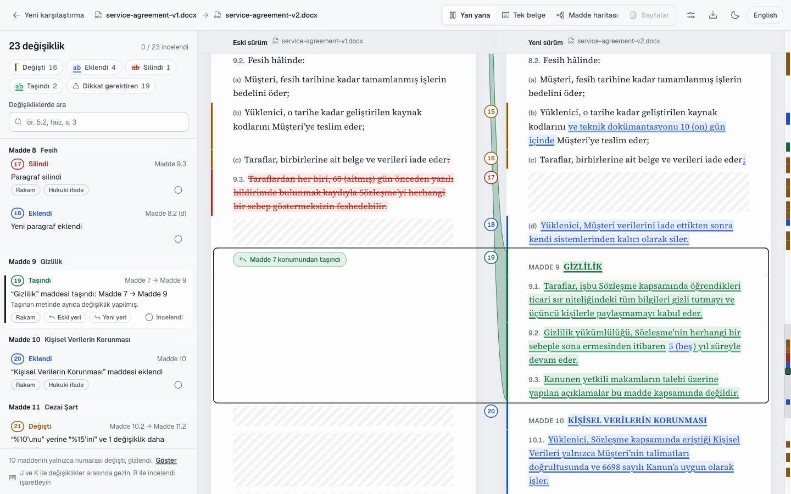
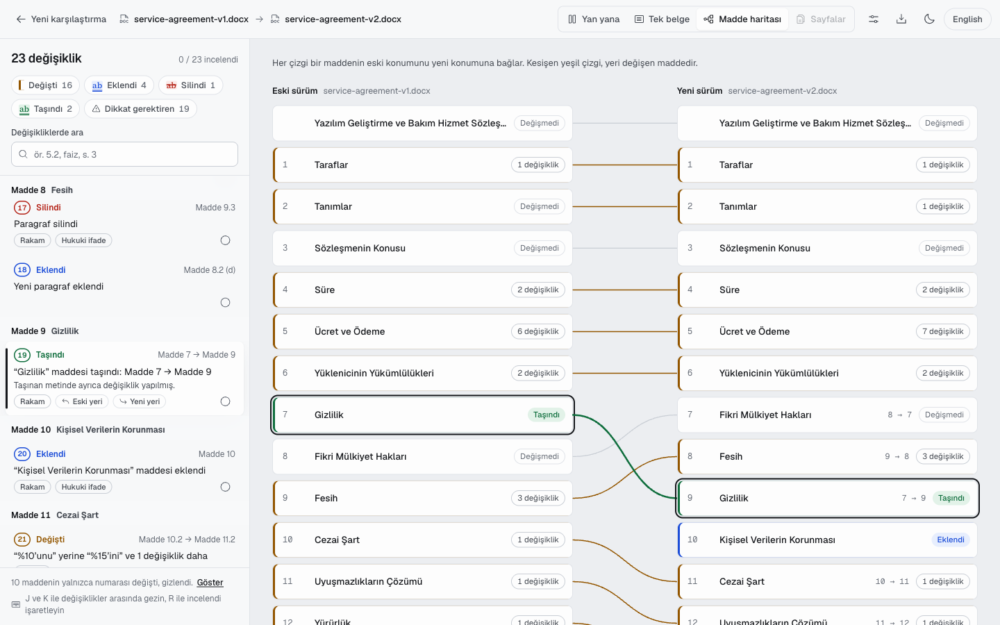
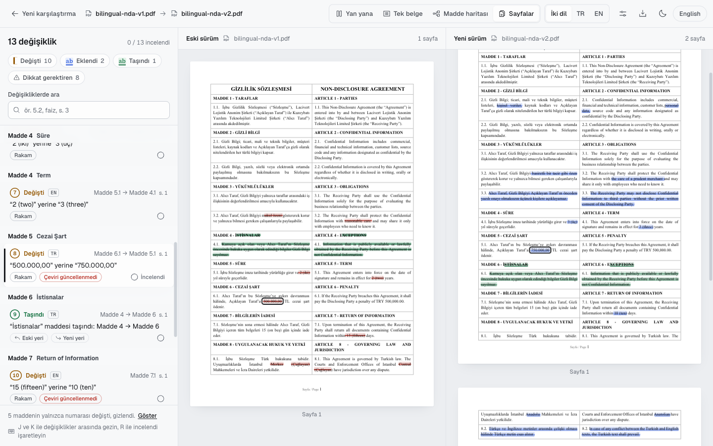
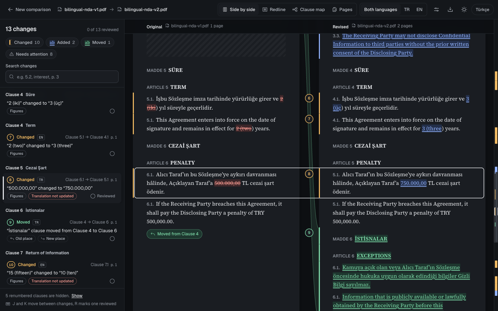
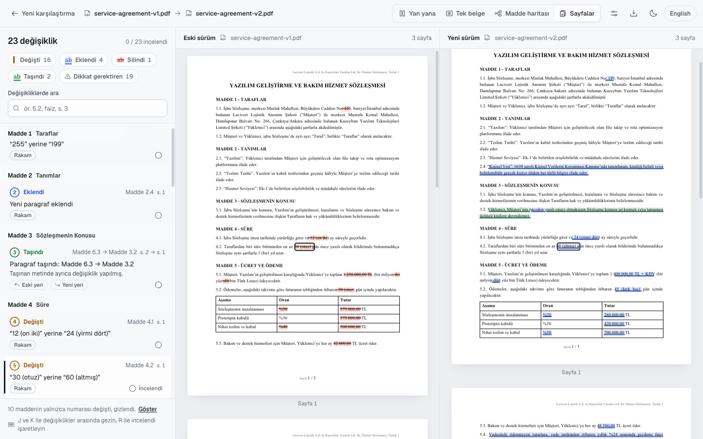
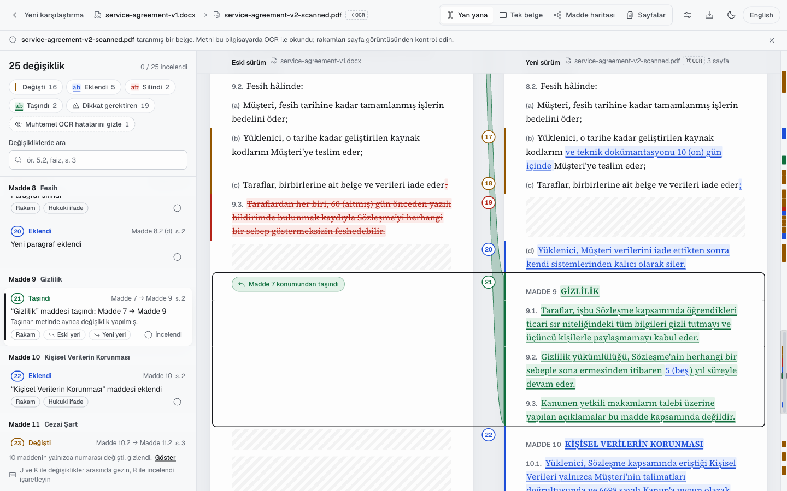
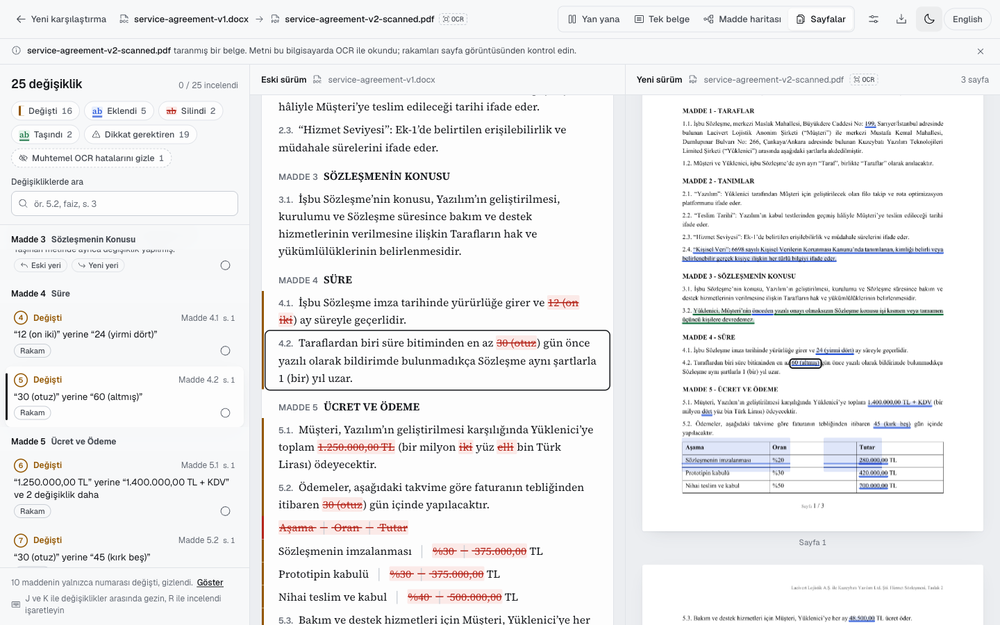

# Redline

Compare two versions of a contract, Word or PDF, and see exactly what changed and where. The view is one a lawyer can read without training. Everything runs in the browser or on your own servers, and no document ever leaves the machine.

Redline is a set of embeddable packages, not a hosted service:

- a framework-free comparison engine
- React components
- a `<redline-viewer>` custom element
- a reference app that ships as a Docker image or as a single HTML file

| Side by side, with a moved clause | Clause map |
|---|---|
|  |  |
| **PDF pages, bilingual NDA** | **Dark theme, English UI: "Translation not updated"** |
|  |  |

More in [docs/screenshots](docs/screenshots/).

## Why

Lawyers review drafts as blacklines. The established tools (Litera Compare, Draftable, Workshare) are closed source and often run in the cloud. Redline is MIT licensed and can run fully on-prem. It uses the conventions those tools already taught lawyers:

| Mark | Meaning |
|---|---|
| <ins>blue, double underline</ins> | inserted text |
| <del>red, strikethrough</del> | deleted text |
| green, double underline | text moved **here** |
| green, double strikethrough | text moved **away** from here |

The line style carries the meaning on its own, so a redline survives black-and-white printing and colour blindness. See [docs/RESEARCH.md](docs/RESEARCH.md) for the market and open-source research behind these choices.

## Features

- **Word, PDF or one of each.** Compare a Word draft against the signed PDF. Plain text and Markdown work too, and other formats can be added as plugins.
- **Clause-aware locations.** The engine reads "MADDE 7", "Article 7", "§ 7", "5.2.", "(b)" and Word's automatic list numbering. Every change is reported with its clause number, heading and page, for example "Clause 5.2, Payment Terms, p. 3".
- **Moves.** Relocated paragraphs and whole articles are detected, even when they were edited after moving. They are shown as a linked pair, so you can jump between the old place and the new one.
- **No renumbering noise.** When a clause is inserted, the clauses after it are renumbered. Those shifted numbers are not reported as changes; the viewer shows a count you can expand.
- **Plain-language descriptions** in English and Turkish, for example: “30 (otuz)” changed to “45 (kırk beş)”, or “Confidentiality” clause moved from Clause 7 to Clause 9.
- **Attention flags:**
  - *Figures*: amounts, dates, durations and percentages.
  - *Legal wording*: shall/may, yükümlüdür/edebilir, liable, negations.
- **Scanned PDFs.** Pages without a text layer are read with OCR on the user's own machine (tesseract.js, Turkish and English data bundled, no CDN). PDFs that already carry an OCR text layer are recognised too. In both cases, differences that look like scanning mistakes are labelled *Possible OCR error* instead of being presented as edits.
- **Bilingual contracts.** Turkish | English two-column layouts are detected, both as Word tables and as PDF columns. An edit made in only one language is flagged *Translation not updated*.
- **Views:**
  - Side by side, with synchronized rows, move connectors and an overview ruler.
  - Redline, a single document.
  - Clause map, showing the structure before and after.
  - Pages: PDF page images with highlights.
- **Review workflow:**
  - Numbered change list grouped by clause, with filters and search.
  - "Reviewed" checkmarks; the host can persist them.
  - Keyboard navigation: `J` / `K` to move, `R` to mark reviewed.
- **Exports:**
  - Printable redline report (HTML, print to PDF).
  - Word file with real tracked changes that can be accepted or rejected in Word.
  - CSV that opens cleanly in Excel with a Turkish locale.
  - JSON.
- **Noise control:**
  - Options to ignore case and punctuation.
  - Normalized automatically: typographic quotes and dashes, non-breaking spaces and ligatures.
  - Removed from PDFs: running headers, footers and page numbers.
- **Privacy by construction.** The app makes no network calls. The nginx config ships a Content Security Policy that forbids connections to any other origin.

## Examples: one contract, three kinds of input

The same Turkish service agreement (`fixtures/service-agreement-v1` → `v2`) compared as Word files, as PDFs, and against a scan of the revised version read with Tesseract OCR. The revised draft changes amounts and periods, deletes a termination right, adds a data-protection article, edits an auto-numbered list and a payment table, and moves two pieces of text: paragraph 6.3 to 3.2 and the whole Confidentiality article from 7 to 9 (renumbering everything in between).

| Input | Files | Result | Outputs |
|---|---|---|---|
| **Word ↔ Word** | `service-agreement-v1.docx` vs `v2.docx` | 23 changes: 16 changed, 4 added, 1 deleted, 2 moved. 10 clauses that were only renumbered are hidden. | [changes (en)](docs/examples/word-vs-word/changes-en.txt), [changes (tr)](docs/examples/word-vs-word/changes-tr.txt), [HTML report](docs/examples/word-vs-word/report-tr.html), [CSV](docs/examples/word-vs-word/changes.csv), [Word with tracked changes](docs/examples/word-vs-word/redline-tracked-changes.docx) |
| **PDF ↔ PDF** | `service-agreement-v1.pdf` vs `v2.pdf` (exported by LibreOffice) | The same 23 changes, identical to Word ↔ Word: headers, footers and page numbers are dropped and paragraphs are rebuilt across page breaks. | [changes (en)](docs/examples/pdf-vs-pdf/changes-en.txt), [changes (tr)](docs/examples/pdf-vs-pdf/changes-tr.txt), [HTML report](docs/examples/pdf-vs-pdf/report-tr.html), [CSV](docs/examples/pdf-vs-pdf/changes.csv), [Word with tracked changes](docs/examples/pdf-vs-pdf/redline-tracked-changes.docx) |
| **Word ↔ scanned PDF (Tesseract OCR)** | `service-agreement-v1.docx` vs `v2-scanned.pdf` (200 dpi greyscale page images, no text layer) | 25 changes. Every real change and both moves are found. 3 are labelled *Possible OCR error*. About 6 s for 3 pages, in the browser or on a server. | [changes (en)](docs/examples/word-vs-scanned-pdf-ocr/changes-en.txt), [changes (tr)](docs/examples/word-vs-scanned-pdf-ocr/changes-tr.txt), [HTML report](docs/examples/word-vs-scanned-pdf-ocr/report-tr.html), [CSV](docs/examples/word-vs-scanned-pdf-ocr/changes.csv), [Word with tracked changes](docs/examples/word-vs-scanned-pdf-ocr/redline-tracked-changes.docx) |
| *Bilingual PDF ↔ PDF* | `bilingual-nda-v1.pdf` vs `v2.pdf` (Turkish and English columns) | 13 changes. Two are flagged *Translation not updated*: the penalty changed only in Turkish, the return period only in English. | [changes (en)](docs/examples/bilingual-pdf-vs-pdf/changes-en.txt), [HTML report](docs/examples/bilingual-pdf-vs-pdf/report-tr.html) |

### Word ↔ Word


The change list as the CLI prints it (`npx redline service-agreement-v1.docx service-agreement-v2.docx`), first lines:

```text
  1  Changed     Clause 1.1             “255” changed to “199”  [Figures]
  2  Added       Clause 2.4             New paragraph added  [Figures]
  3  Moved       Clause 6.3 -> Clause 3.2 Paragraph moved from Clause 6.3 to Clause 3.2
  4  Changed     Clause 4.1             “12 (on iki)” changed to “24 (yirmi dört)”  [Figures]
  5  Changed     Clause 4.2             “30 (otuz)” changed to “60 (altmış)”  [Figures]
  6  Changed     Clause 5.1             “1.250.000,00 TL” changed to “1.400.000,00 TL + KDV” and 2 more  [Figures]
 13  Changed     Clause 6.1             “etmek için makul çabayı gösterecektir” changed to “etmekle yükümlüdür”  [Legal wording]
 17  Deleted     Clause 9.3             Paragraph deleted  [Figures, Legal wording]
 19  Moved       Clause 7 -> Clause 9   “Gizlilik” clause moved from Clause 7 to Clause 9  [Figures]
 20  Added       Clause 10              “Kişisel Verilerin Korunması” clause added  [Figures, Legal wording]
```

### PDF ↔ PDF

The *Pages* view draws the same marks on the real PDF pages.



### Word ↔ scanned PDF (Tesseract OCR)

The scan has no text layer. `@redline/ocr` recognises it in the browser, and `redline --ocr` does the same on a server. Nothing is uploaded either way. The revised side gets an *OCR* badge and a notice to check figures against the page image.





The differences OCR adds compared with the clean PDF:

| Change | Shown as | Why |
|---|---|---|
| “1 (bir)” read as “\| (bir)” | *Possible OCR error* | 1, l and \| are a classic misreading |
| “Yazılım’da” read as “Yazilim’da” | *Possible OCR error* | dotless ı read as i |
| “%30” → “%20” read as “%30” → ““020” | *Figures* (a real change) | 3 → 2 is a digit-to-digit change, so it is never labelled OCR, even though the % sign was also misread |
| (c) “.” → “;” | *Possible OCR error* | **A real edit carrying the noise label.** Punctuation swaps are exactly what OCR gets wrong, so the label is advisory and the change stays visible |

The label never hides anything by default. Reviewers can filter the labelled changes out once they have checked them on the page image.

## Packages

| Package | What it is | Use it when |
|---|---|---|
| [`@redline/core`](packages/core) | Parsing, alignment, move detection, word diff, locales, exports. No UI, no DOM required. | Server-side comparison, Web Workers, or a custom UI |
| [`@redline/ocr`](packages/ocr) | In-browser OCR provider (tesseract.js) plus `redline-ocr-assets`, which copies the worker, WebAssembly core and language data to your static folder | Users compare scanned PDFs and the scan must not leave their machine |
| [`@redline/react`](packages/react) | `RedlineViewer`, `FilePicker`, `useComparison` and the individual views | The host product uses React 18 or newer |
| [`@redline/element`](packages/element) | `<redline-viewer>` custom element in a shadow root, with React bundled inside | Angular, Vue, server-rendered pages, plain HTML |
| [`apps/demo`](apps/demo) | Reference app: file picker plus viewer, bundled samples | A standalone on-prem tool (Docker or single HTML file) |

## Architecture

```text
 File | Blob | ArrayBuffer | { name, bytes }
              │
              ▼
 parseDocument()                         parsers/registry.ts  (registerParser for new formats)
   ├─ docx  JSZip + OOXML: styles, Word list numbering, tables, page hints, tracked changes
   ├─ pdf   pdf.js text runs → words with boxes → lines → paragraphs
   │        header/footer removal, hyphen joining, two-column detection
   └─ text  plain text / Markdown
              │  columns.ts: two columns in two languages → bilingual document
              ▼
 DocModel { blocks: heading | para | row, clause label, page, word boxes, column, language }
              │
              ▼
 compareDocs(a, b, options)
   align.ts    1. Myers diff on normalised paragraphs → unchanged anchors
               2. identical paragraphs in another place → moves
               3. similar paragraphs inside a gap → edits (order-preserving matching)
               4. similar paragraphs elsewhere → moved and edited
   inline.ts   word-level diff per paragraph (Unicode, Turkish-aware), readability cleanup
   compare.ts  changes with locations, figure/legal flags, bilingual mirror check
              │
              ▼
 Comparison { ops, rows, changes, stats }
              │
   ┌──────────┼──────────────────────┬─────────────────────────────┐
   ▼          ▼                      ▼                             ▼
 render.ts  describe.ts + locales  export/: HTML report,         @redline/react views
 (spans)    (sentences, en/tr)     tracked-changes DOCX, CSV,    └─ @redline/element
                                   JSON
```

## Quick start

Requires Node 20.19+ or 22.12+.

```bash
npm install
npm run dev          # demo app at http://localhost:5173 (try the bundled samples)
npm test             # engine tests against the fixtures (DOCX, PDF, mixed, bilingual)
npm run build        # libraries (dist/) and the demo app
npm run fixtures     # regenerate sample documents (PDF copies need LibreOffice)
```

## Integration

### React

```tsx
import { RedlineViewer } from '@redline/react';
import '@redline/react/styles.css';
import '@redline/react/fonts.css'; // optional: bundled Geist + Source Serif 4; omit to use your own fonts

export function ContractDiff({ previous, current }: { previous: File; current: File }) {
  return (
    <RedlineViewer
      original={previous}
      revised={current}
      locale="tr"                        // 'en' | 'tr' | a custom Messages object; default: browser language
      theme="system"                     // 'light' | 'dark' | 'system'
      reviewed={reviewedKeys}            // persist review progress in your backend
      onReviewedChange={saveReviewedKeys}
      onChangeSelect={(change) => console.log(change)}
      onBack={() => navigate('/contracts')}
      toolbarEnd={<ShareButton />}       // your own actions in the toolbar
      exports={['print', 'docx', 'csv']}
      style={{ height: '100vh' }}
    />
  );
}
```

`RedlineViewer` props:

| Prop | Type | Notes |
|---|---|---|
| `original`, `revised` | `File \| Blob \| ArrayBuffer \| { name, bytes }` | Parsed and compared inside the component |
| `comparison` | `Comparison` | Alternatively, pass a comparison computed elsewhere (server, worker) |
| `options` / `defaultOptions` / `onOptionsChange` | `Partial<CompareOptions>` | Controlled or uncontrolled compare settings |
| `locale` | `'en' \| 'tr' \| Messages` | All visible strings come from the locale |
| `theme` / `onThemeChange` | `'light' \| 'dark' \| 'system'` | `onThemeChange` fires when the user flips the theme, so you can remember it |
| `view` / `defaultView` / `onViewChange` / `views` | `'side' \| 'redline' \| 'map' \| 'pages'` | `views` limits which views are offered |
| `reviewed` / `defaultReviewed` / `onReviewedChange` | `string[]` | Stable keys from `changeKey(change)` |
| `onChangeSelect` | `(change \| null) => void` | Fires when the user selects a change |
| `onBack` | `() => void` | Shows a "New comparison" button |
| `toolbarEnd` | `ReactNode` | Slot for host actions |
| `exports` / `onExport` | `('print' \| 'docx' \| 'csv' \| 'json')[] \| false` | `onExport(kind, file, filename)` replaces the browser download, e.g. to store the file in your DMS |
| `onError` | `(error: Error) => void` | A crash inside a view is contained (the rest of the viewer keeps working) and reported here |

For a custom layout, compose the pieces yourself. `useComparison(original, revised, options)` returns `{ status, comparison, error }`. Each view (`SideBySideView`, `RedlineView`, `ClauseMap`, `PageView`) takes the same `ViewProps` (`packages/react/src/views/types.ts`).

`FilePicker` is the two-slot upload screen from the demo. Its props are `onCompare(original, revised)`, `samples`, `locale`, `theme`, `busy` and `error`.

### Web Component (any framework)

```html
<script type="module" src="/vendor/redline-element.js"></script>

<redline-viewer locale="tr" theme="system" view="side" style="height: 100vh"></redline-viewer>

<script type="module">
  const viewer = document.querySelector('redline-viewer');
  viewer.compare(originalFile, revisedFile);              // File | Blob | ArrayBuffer
  viewer.addEventListener('redline-ready', (e) => console.log(e.detail.stats));
  viewer.addEventListener('redline-select', (e) => console.log(e.detail.change));
  viewer.addEventListener('redline-reviewed', (e) => save(e.detail.keys));
  viewer.addEventListener('redline-error', (e) => console.warn(e.detail.code));
</script>
```

- **Attributes:** `locale`, `theme`, `view`, and `fonts="none"` to keep the host page's fonts.
- **Properties:** `original`, `revised`, `comparison`, `options`, `reviewed`.
- **Styles:** live in the shadow root, so the host page and the viewer cannot affect each other.
- **Build:** `npm run build -w packages/element` produces `packages/element/dist/redline-element.js`.
- **Example:** [packages/element/examples/vanilla.html](packages/element/examples/vanilla.html).

### Server side (Node)

The engine runs in Node with no DOM. It falls back to `@xmldom/xmldom` and the pdf.js legacy build. This is useful for batch comparisons, audit trails, or generating reports from a DMS.

```ts
import { readFile, writeFile } from 'node:fs/promises';
import { compareFiles, toHTMLReport, toJSON, toTrackedDocx, tr } from '@redline/core';

const cmp = await compareFiles(
  { name: 'draft-3.docx', bytes: await readFile('draft-3.docx') },
  { name: 'signed.pdf', bytes: await readFile('signed.pdf') },
  { ignoreCase: false },
);

console.log(cmp.stats);                                    // { mod, ins, del, move, total, flagged, ... }
await writeFile('changes.json', JSON.stringify(toJSON(cmp, tr), null, 2));
await writeFile('report.html', toHTMLReport(cmp, tr));     // printable, no scripts, no external assets
await writeFile('redline.docx', Buffer.from(await toTrackedDocx(cmp, tr)));
```

`toJSON(comparison)` is a plain, stable summary for APIs, audit logs and search indexes.

To show a server-side comparison in the viewer, send the two parsed documents (`DocModel` is plain JSON) and run `compareDocs` in the browser. It is cheap: about 50 ms for a 250-page contract. Then pass the result as the `comparison` prop.

### Command line

The core package ships a `redline` binary for scripts, CI and batch jobs. The exit code is 0 when the documents are identical, 1 when they differ and 2 on error.

```bash
npx redline draft.docx signed.pdf                      # numbered change list
npx redline v1.docx v2.docx --format json > changes.json
npx redline v1.pdf v2.pdf --format html --out report.html --lang tr
npx redline v1.docx v2.docx --format docx --out redline.docx   # Word file with tracked changes
```

Options: `--ignore-case`, `--ignore-punctuation`, `--no-moves`, `--renumbering`.

## Configuration

### Compare options

| Option | Default | Effect |
|---|---|---|
| `ignoreCase` | `false` | Upper/lower case differences are not changes (Turkish dotted/dotless i handled) |
| `ignorePunctuation` | `false` | Punctuation-only differences are not changes |
| `detectMoves` | `true` | Report relocated text as moves instead of delete + insert |
| `showRenumbering` | `false` | Report clauses whose only change is their number |
| `profile` | Turkish + English | Language/jurisdiction knowledge, see below |

### Profiles: clause words and legal vocabulary

A profile is plain data, so you can add jurisdictions without touching the engine:

```ts
import { compareFiles, english, mergeProfiles, type Profile } from '@redline/core';

const german: Profile = {
  articleWords: ['§', 'Artikel', 'ARTIKEL', 'Abschnitt'],
  legalStems: ['haft', 'verpflicht', 'kündig', 'vertragsstraf', 'gewährleist'],
  legalWords: ['muss', 'darf', 'kann', 'nicht', 'unverzüglich', 'schriftlich'],
  smallWords: ['und', 'oder', 'der', 'die', 'das', 'von'],
  negations: ['\\bnicht\\b', '\\bkein\\w*'],
};

const cmp = await compareFiles(a, b, { profile: mergeProfiles(german, english) });
```

Each field drives one behaviour:

| Field | What it drives |
|---|---|
| `articleWords` | How clause headings are recognised ("MADDE 7", "§ 7") |
| `legalStems`, `legalWords`, `negations` | The *Legal wording* flag |
| `smallWords` | Which words stay lower-case when ALL-CAPS headings are title-cased |

### Languages

Bundled locales are `en` (the source of truth) and `tr`. Add a language by typing an object against `Messages`; TypeScript reports anything missing:

```ts
import { en, type Messages } from '@redline/core';
export const de: Messages = { ...en, locale: 'de', /* translated strings */ };
// <RedlineViewer locale={de} />   or   describeChange(change, de)
```

### New file formats

```ts
import { registerParser } from '@redline/core';

registerParser({
  kind: 'odt',
  extensions: ['odt'],
  detect: (head, name) => name.toLowerCase().endsWith('.odt'),
  parse: async (bytes, ctx) => ({ id: ctx.id, name: ctx.name, kind: 'odt', size: bytes.byteLength, blocks: myBlocks, warnings: [] }),
});
```

A parser returns `DocModel` blocks: headings, paragraphs and table rows, each with a clause label and optional page and word boxes. The rest of the pipeline is format-agnostic.

### Theming

The viewer's styles are scoped to the `.rl` root. Utilities are prefixed with `rl:` and no global reset is shipped, so nothing leaks into the host. To re-theme, override these CSS variables on `.rl` (and on `.rl[data-theme='dark']`):

| Group | Variables |
|---|---|
| Surfaces | `--rl-canvas`, `--rl-surface`, `--rl-paper` |
| Text and lines | `--rl-ink`, `--rl-ink-2`, `--rl-ink-3`, `--rl-line`, `--rl-line-strong`, `--rl-hover` |
| Change colours | `--rl-ins` / `--rl-ins-bg`, `--rl-del` / `--rl-del-bg`, `--rl-mov` / `--rl-mov-bg`, `--rl-mod` / `--rl-mod-bg` |
| Fonts | `--rl-font-ui`, `--rl-font-doc`, `--rl-font-mono` |
| Shape | `--rl-radius`, `--rl-radius-lg`, `--rl-shadow` |

### PDF worker and strict CSP

The pdf.js worker is bundled inline and started from a `blob:` URL, so there is nothing extra to serve. If your CSP forbids `blob:` workers, serve `pdf.worker.min.mjs` from your own origin and configure it before the first PDF is opened:

```ts
import { configurePdf } from '@redline/core';
configurePdf({ workerSrc: '/static/pdf.worker.min.mjs' });
```

## OCR (scanned PDFs)


A scanned contract has no text, only page images. Redline handles three cases:

| The PDF... | What happens |
|---|---|
| has a normal text layer | Compared as usual |
| is a scan with an OCR text layer (made by a scanner, Acrobat, ABBYY, OCRmyPDF) | Compared as usual; differences that look like scanning mistakes are labelled *Possible OCR error* |
| is a scan without text | Read with the configured OCR engine, then compared. Without an engine it is rejected with a message saying OCR is needed |

### In the browser (`@redline/ocr`)

Recognition runs in a Web Worker on the user's machine. The worker, the WebAssembly engine and the language data are served from your own origin; nothing is fetched from a CDN and no page image leaves the browser.

```bash
npm install @redline/ocr
npx redline-ocr-assets public/ocr                 # Turkish + English, about 17 MB
npx redline-ocr-assets public/ocr --langs tur,eng,deu   # extra languages: npm install @tesseract.js-data/deu
```

```tsx
import { createTesseractOcr } from '@redline/ocr';

// Create once and reuse; the worker starts on the first scanned page and is cached afterwards.
const ocr = createTesseractOcr({ assetsUrl: '/ocr', langs: ['tur', 'eng'] });

<RedlineViewer original={a} revised={b} ocr={ocr} />;
// Web Component: <redline-viewer ocr-assets="/ocr" ocr-langs="tur,eng"></redline-viewer>
// Core only:     await compareFiles(a, b, { ocr });
```

- **CSP:** add `'wasm-unsafe-eval'` to `script-src` so the engine can compile its WebAssembly (it does not allow `eval`). The worker is loaded from its own URL, so `worker-src 'self'` is enough. `deploy/security-headers.conf` already has both.
- **Serving:** the `.traineddata.gz` files must be served as plain binaries, without `Content-Encoding`; the engine decompresses them itself (see the `/ocr/` location in `deploy/nginx.conf`).
- **Speed:** about 2 seconds per A4 page at 300 dpi on an Apple-silicon laptop. The bundled 3-page scanned fixture takes 5.6 s in headless Chromium, including engine start and loading the language data. Lower `dpi` (for example 200) is faster but less accurate. The viewer shows "Reading scanned page 2 of 5" while it works, and leaving the comparison cancels the OCR.
- **Accuracy on the fixture:** the scanned revision against the original Word file yields 27 differences, against 23 from the clean PDF. The extra ones are character-level misreadings, shown next to the page image so they are quick to dismiss.
- **Caching:** language data is cached in the browser's IndexedDB after first use, on that machine only.

### What gets labelled *Possible OCR error*

Only documents whose text came from OCR are checked. A difference is labelled when every character that differs can be explained by a typical scanning confusion, and the difference is short:
- `1`/`l`/`I`/`|` and `0`/`O`/`%`
- straight versus curly quotes and apostrophes
- a Turkish diacritic lost or gained (`ş`/`s`, `ı`/`i`, `ğ`/`g`)
- `rn` read as `m`
- stray marks added or dropped

These changes are listed, never hidden by default. The change list has a filter to hide them, and the *Pages* view shows the scan under the highlight so you can check it at a glance.

A digit replaced by another digit is **never** labelled OCR: "%24" becoming "%25" is always reported as a real change. Even so, check figures in a scanned signed copy against the page image. OCR can misread a changed digit as the old one, and then no difference appears at all.

### On a server

The `redline` CLI from `@redline/core` can OCR scanned pages with the Tesseract command-line tools. It needs `tesseract` (with the `tur` and `eng` language data) and `pdftoppm` (poppler-utils) on `PATH`:

```bash
npx redline draft.docx signed-scan.pdf --ocr --lang tr
```

You can also make scans searchable before they reach Redline, for example with [OCRmyPDF](https://ocrmypdf.readthedocs.io/) as a batch step or sidecar container next to your DMS:

```bash
ocrmypdf -l tur+eng --deskew signed-scan.pdf signed-scan-ocr.pdf
```

The result has an OCR text layer, so it takes the "OCR text layer" path in the table above.

### Other OCR engines

Any engine fits behind the `OcrProvider` interface from `@redline/core`: ABBYY FineReader Server, an Azure Document Intelligence container, or an internal service. Return words in PDF units (1/72 inch, top-left origin), with a line id so the engine can rebuild lines:

```ts
import type { OcrProvider } from '@redline/core';

export const companyOcr: OcrProvider = {
  name: 'company-ocr',
  async recognize(page, signal) {
    const scale = 300 / 72;
    const canvas = await page.render!(scale);   // browser; on a server, rasterise page.pdf yourself
    const png = await (canvas as OffscreenCanvas).convertToBlob({ type: 'image/png' });
    const res = await fetch('/internal/ocr', { method: 'POST', body: png, signal }); // add this origin to connect-src
    const lines: { id: number; words: { text: string; box: [number, number, number, number]; conf: number }[] }[] = await res.json();
    return lines.flatMap((l) =>
      l.words.map(({ text, box: [x0, y0, x1, y1], conf }) => ({
        text, x: x0 / scale, y: y0 / scale, w: (x1 - x0) / scale, h: (y1 - y0) / scale, confidence: conf, line: l.id,
      })),
    );
  },
};
```

## On-prem deployment

### Docker (nginx)

```bash
docker build -f deploy/Dockerfile -t redline .
docker run --rm -p 8080:8080 redline
# or
docker compose -f deploy/docker-compose.yml up --build
```

- **Image:** a static site on `nginx:1.27-alpine` with a read-only root filesystem, dropped capabilities and a `/healthz` endpoint.
- **CSP** (`deploy/security-headers.conf`):
  - `script-src 'self'` and `connect-src 'self' data: blob:` mean the page can neither load foreign code nor send a document anywhere.
  - `'wasm-unsafe-eval'` lets the OCR engine compile its WebAssembly; it does not enable `eval`.
- **OCR runtime:** the image build copies the OCR worker, engine and language data to `/ocr/` (served by its own nginx location, cached for a day).
  - `form-action 'none'` and `frame-ancestors 'self'` are set as well.
- **Embedding:** to embed the viewer in another intranet application on a different origin, adjust `frame-ancestors`.

### Single HTML file

```bash
npm run build:single     # → apps/demo/dist-single/index.html
```

One self-contained file with the engine, the pdf.js worker, fonts and samples inlined. You can open it from a network share or a USB stick, with no server at all.

OCR is the exception. Its engine and language data (about 17 MB) are not inlined; the build writes them to `dist-single/ocr/` next to the file. Served over http(s) with that folder beside it, OCR works. Browsers do not start workers from `file://` pages, so when the file is opened straight from disk, OCR is switched off and scanned PDFs show the "needs OCR" message. Text PDFs, OCR'd PDFs and Word files work either way.

### Inside your product

Install `@redline/react` (or drop in `redline-element.js`) and keep your existing hosting. The packages make no network requests. Nothing has to be allow-listed beyond your own origin and `blob:` workers (or `workerSrc`, see above). With OCR, also serve the `redline-ocr-assets` folder and add `'wasm-unsafe-eval'` to `script-src`.

## Testing

```bash
npm test
```

The engine tests live in `packages/core/test` and run in Node against the documents in `fixtures/`:

- `service-agreement-v1/v2.docx` and `.pdf`: a Turkish service agreement. It has articles, a Word auto-numbered (a)(b)(c) list, a payment table, an edited and moved article, a moved paragraph, a deleted termination right, a new article, and renumbered clauses that must not be reported.
- `bilingual-nda-v1/v2.docx` and `.pdf`: a Turkish | English NDA in two columns. Most edits are mirrored in both languages. Two are deliberately one-sided: the penalty changes only in Turkish, and the return period only in English.

The tests also check:
- PDF parsing against the Word original
- PDF↔PDF compared to DOCX↔DOCX
- exports

Regenerate the fixtures with `npm run fixtures` (Node + LibreOffice).

## Limitations and roadmap

- **OCR quality** depends on the scan. Low-resolution, skewed or stamped pages produce more misreadings. Readings are labelled where they look like scanning mistakes, but OCR can never prove that a figure is unchanged. Handwriting and signatures are not read. OCR runs one page at a time in a single worker; a worker pool for long scans is planned.
- **Formatting-only changes** (bold, font, indentation) are not reported yet; Redline compares text and structure.
- **Word export** writes moves as a deletion plus an insertion; Word's native move markup (`w:moveFrom` / `w:moveTo`) is planned.
- **Headers, footers, footnotes and comments** in Word files are not compared yet.
- **Main-thread comparison.** The comparison runs on the main thread, which is fine for contracts up to a few hundred pages. The engine is already worker-safe, and a Web Worker transport is planned for very large documents.
- **Newspaper-style multi-column PDFs** are read as two parallel columns (the bilingual model).
- **Optional DOCX engine.** [Docxodus](https://github.com/JSv4/Docxodus) (MIT, WebAssembly) could be plugged in as an alternative DOCX comparer for formatting-level fidelity.

## License

[MIT](LICENSE). Dependencies are MIT, BSD or Apache-2.0: pdf.js, JSZip, jsdiff, docx, @xmldom/xmldom, React, Phosphor Icons, tesseract.js and its language data (Apache-2.0), and the Geist and Source Serif fonts (SIL OFL).
